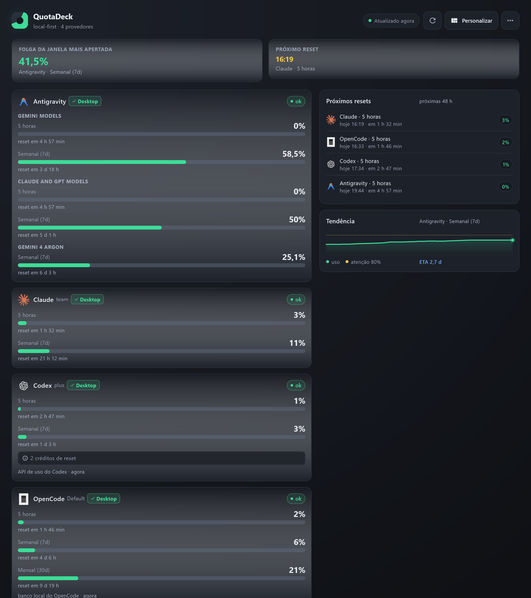
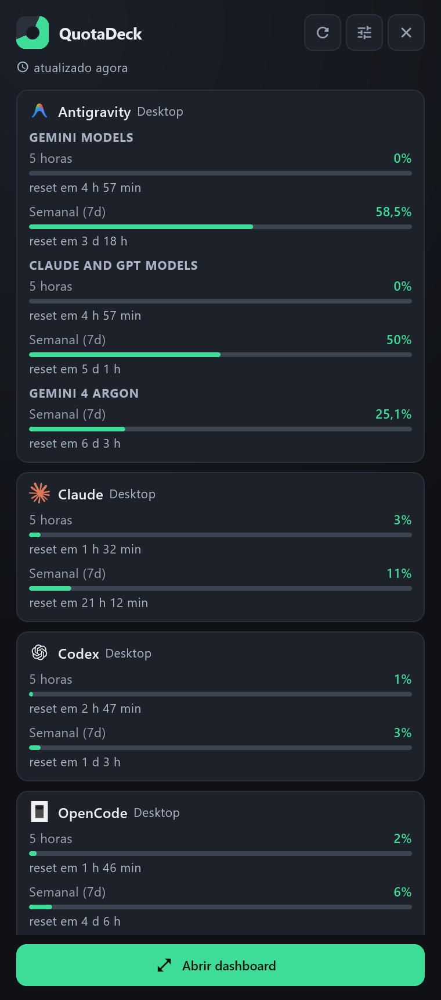
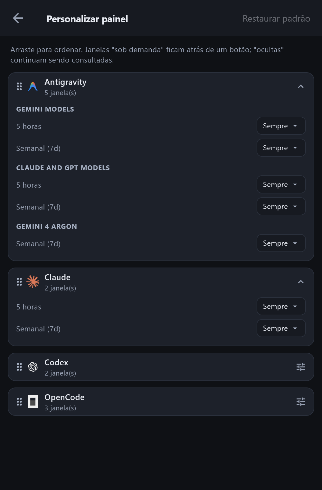

# QuotaDeck

App de bandeja (Windows, macOS e Linux) + CLI (`qdeck`) pra parar de tomar block surpresa de rate limit alternando entre **OpenCode**, **Antigravity**, **Codex** e **Claude**.

A ideia é simples: não tem login, não tem proxy e não gasta token fazendo teste. Ele só lê as credenciais que já estão na máquina e junta as janelas de 5h, semanais e mensais num painel só — te avisa quando passa de um limite configurável e mostra uma estimativa de quando vai zerar.

> Por enquanto ele monitora esses quatro, mas se quiserem adicionar novos providers podem ficar à vontade pra colaborar!



## O que ele faz

- **Zero configuração de conta:** detecta o que já está instalado na máquina (Desktop ou CLI) e lê a sessão local em modo somente-leitura.
- **Fica na bandeja:** o ícone muda de cor conforme o uso e um clique abre o popover mini com o resumo rápido.
- **Avisa antes de estourar:** manda notificação nativa quando passa do limite configurado (ex.: 80% e 95%) e calcula em quanto tempo a quota vai zerar.
- **Painel ajustável:** dá pra reordenar os provedores e esconder as janelas que você não quer ver toda hora.

| Popover Mini na Bandeja | Personalizar Painel |
| :---: | :---: |
|  |  |

## Linha de comando (`qdeck`)

Pra quem prefere terminal ou quer jogar na statusline do shell/tmux:

```bash
qdeck show
qdeck statusline   # ex: OC 21% · AG 58,5% · CX 3% · CL 11%
qdeck doctor
```

Exemplo do `qdeck show`:

```text
Provedor     Conta                  Janela                                Uso                           Reset          Status
-----------  ---------------------  ------------------------------------  ----------------------------  -------------  ------
OpenCode     OpenCode (Default)     5 horas                               [░░░░░░░░░░░░░░░░░░░░] 2%     em 1 h 46 min  ok
Antigravity  Antigravity            Semanal (7d) · Gemini Models          [███████████░░░░░░░░░] 58,5%  em 3 d 18 h    ok
Codex        Codex (plus)           5 horas                               [░░░░░░░░░░░░░░░░░░░░] 1%     em 2 h 47 min  ok
Claude       Claude Desktop (team)  5 horas                               [░░░░░░░░░░░░░░░░░░░░] 3%     em 1 h 32 min  ok
```

Pra ativar o `qdeck` globalmente no terminal:

```bash
cd packages/cli
dart pub global activate --source path .
```

## Instalar ou rodar local

**Windows:** baixe o `quota_deck-<versão>-setup.exe` na [release mais recente](https://github.com/thiagoperea/quota_deck/releases) (instala sem pedir admin).

**Rodar ou buildar do código (Windows, macOS e Linux):**

```bash
git clone https://github.com/thiagoperea/quota_deck.git
cd quota_deck/app
flutter pub get
flutter run -d windows    # ou -d macos / -d linux
```

## Licença

MIT. Mais detalhes sobre arquitetura e leitura local em [`docs/`](docs/).
